# Mekstrike

## Overview

Mekstrike is a Kubernetes‑native, Dapr‑powered tactical mech combat sandbox. It models a hex battlefield, mechs (units), turns/phases, and player/AI actions, orchestrated by a Go "gamemaster" service. Core logic is split across services: Java actors for `battlefield` and `unit`, a Java `armybuilder`, Go services for `library`, `importer`, and `mediaproxy`, a Python `ai-agent` that reacts to events, and a SvelteKit `ui` for visualization and control. Communication uses Dapr sidecars (HTTP/gRPC, pub/sub, state). Shared Protocol Buffers live under `domain/`. Scripts (`setup.sh`, `deploy.sh`) spin up the platform and deploy to a local Minikube profile (`mekstrike`).

Use this repo to run the full stack locally, iterate on rules, and experiment with service boundaries and AI behaviors.

## Running / trying

### Requirements

- Kubernetes with an ability to build images on the nodes. For simplicity sake; docker-desktop or minikube (untested)
- This will install a traefik ingress. If you already have an ingress, you'll need to fix yourself using the resources in the k8s folder.

### Quickstart

```sh
# OSX: Start minikube; For other OS's, use your K8s flavor of choice
minikube start --driver vfkit --network vmnet-shared --cpus=8 --memory=12g --disk-size=60g --profile mekstrike

# Set up a kubernetes platorm, with certman, dapr, jaeger, otel
./setup.sh

# Build and deploy
./deploy.sh

# Incremental deploy
./deploy.sh ui # or gamemaster, armybuilder, unit, battlefield, etc.
```

## Developing: requirements

- GoLang 
- DotNet 
- Java 
- Maven 
- Node

## Components

desired:


### library

- golang
- rest endpoints for querying unit data

### armybuilder

- java
- grpc service for creating an army
  - Takes input parameters for generating a force
  - Generate force - query library for units
  - creates and returns unit URI's
  
### gamemaster

- Go
- REST
  - players
  - the battlefield
  - involved units
  - rounds / phases

### battlefield

- java
- Actor
  - Given board x, can a unit move from x to y?
  - etc

### unit

- Java
- Actor
  - Move here
  - Fire there
  - Handle IncomingFire?
  - knows which map its on, and its location

### AI-Agent
- Python
- Reacts to events in the game to move AI units, declare AI shots, etc

### fireControlSystem

- C#
  - will translate *shots* to *incoming fire*, given RNG and all kinds of considerations;
  - CLIENT -> source unit(fire) -> FireControlSystem(verifyShot) -> target unit(processIncoming)
  
### API Gateway

- A simple API gateway so client does not need knowledge of backend services?

### UI

- Svelte webapp
- CSS: <https://terminalcss.xyz/>
